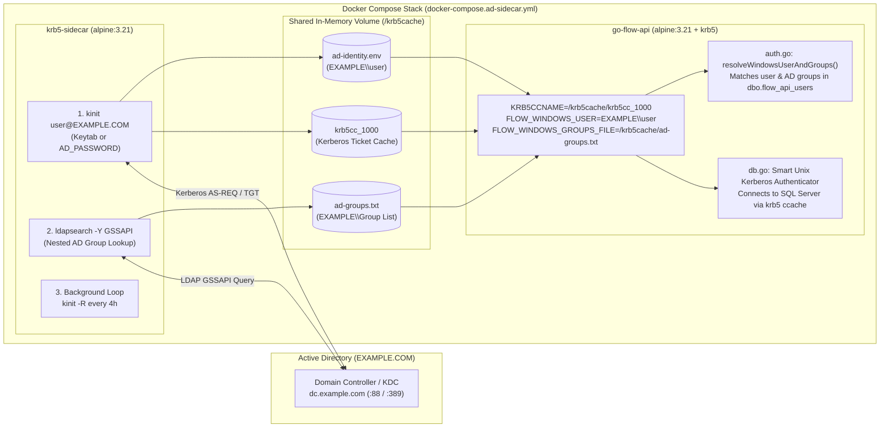

# `go-flowAPI` — Active Directory Kerberos (`klist`) Sidecar Guide

This guide explains how to run **`go-flowAPI`** inside a Linux Docker container under an **Active Directory user identity** using a **Kerberos (`kinit` / `klist`) sidecar container**.

By pairing `go-flow-api` with the `krb5-sidecar` service over an in-memory `tmpfs` volume (`/krb5cache`), your Linux container gains:
1. **Kerberos Ticket Granting Tickets (`klist`)**: Acquired or reused on startup and refreshed every 4 hours in a shared `tmpfs` volume.
2. **Integrated Kerberos SQL Server & Pipeline Execution**: The API database and appropriately configured pipeline SQL Server connections can authenticate with the shared Kerberos ticket cache.
3. **Automatic AD Group Membership Resolution**: Queries Active Directory over GSSAPI (`ldapsearch`) using `LDAP_MATCHING_RULE_IN_CHAIN` to resolve nested `EXAMPLE\<group>` memberships into `/krb5cache/ad-groups.txt`.
4. **Seamless `go-flowAPI` RBAC Integration**: Maps the sidecar's `EXAMPLE\<user>` and resolved `EXAMPLE\<group>` memberships directly against `dbo.flow_api_users` (`FLOW_WINDOWS_USER` and `FLOW_WINDOWS_GROUPS_FILE`).

---

## 1. Architecture Overview



---

## 2. Included Files

| File | Purpose |
| :--- | :--- |
| **[`docker-compose.ad-sidecar.yml`](../docker-compose.ad-sidecar.yml)** | Launches `krb5-sidecar` and `go-flow-api` sharing the in-memory `krb5_cache` volume (`/krb5cache`). *(Use `private-docker-compose.ad-sidecar.yml` for local git-ignored overrides.)* |
| **[`docker/krb5.conf`](../docker/krb5.conf)** | Template Kerberos client configuration (`EXAMPLE.COM`). *(Use `docker/private-krb5.conf` for local git-ignored overrides.)* |
| **[`docker/krb5-sidecar-entrypoint.sh`](../docker/krb5-sidecar-entrypoint.sh)** | Sidecar entrypoint script that acquires the TGT (`kinit`), verifies with `klist -f`, resolves nested AD groups into `/krb5cache/ad-groups.txt`, and renews tickets automatically. |
| **[`Dockerfile`](../Dockerfile)** | Includes `krb5` and `krb5-libs` in the Alpine runtime stage so `klist` and GSSAPI work inside `go-flow-api`. |
| **[`db.go`](../db.go)** | Registers a Linux integrated authenticator that can use the Kerberos ticket cache (`KRB5CCNAME`). |
| **[`auth.go`](../auth.go)** | Reads `FLOW_WINDOWS_USER`, `FLOW_WINDOWS_GROUPS`, and `FLOW_WINDOWS_GROUPS_FILE` (`/krb5cache/ad-groups.txt`) during Windows/AD authentication. |

---

## 3. Quickstart: Starting the Sidecar Stack

Authenticate the `krb5-sidecar` using **Method A (Password)** or **Method B (Keytab File — Recommended for Production)**. Method C supplies a static group list in addition to a valid ticket.

*(If you are using your local git-ignored files, substitute `-f private-docker-compose.ad-sidecar.yml` below.)*

Compose also reads a root `.env` file automatically. The root `.env` is ignored by Git and excluded from the Docker build context; it can contain `AD_USER` and `AD_PASSWORD` as `KEY=value` entries. It is still a plaintext local file, so restrict access to it and never commit or share it.

Before starting, configure the mounted `krb5.conf` for your realm and reachable domain controller, and use a SQL Server hostname with a registered `MSSQLSvc` SPN. The controller must be reachable from the containers on Kerberos port 88. Setting `AD_DC_HOST` changes the LDAP lookup host; it does not replace the KDC settings in `krb5.conf`. The logged-in Windows user's ticket is not automatically shared with the Linux containers.

### Method A: Authenticate with `AD_USER` and `AD_PASSWORD`

#### PowerShell (Windows)
```powershell
$env:AD_DOMAIN = "EXAMPLE"
$env:AD_REALM = "EXAMPLE.COM"
$env:AD_USER = "svc_goflow"
$env:AD_PASSWORD = "YourActiveDirectoryPassword"
$env:FLOW_API_DSN = "sqlserver://db.example.com:1433?database=EXAMPLE_DB&integrated+security=true&authenticator=krb5&trustServerCertificate=true"

docker compose -f docker-compose.ad-sidecar.yml up -d --build
```

#### Bash / Linux / macOS
```bash
AD_DOMAIN="EXAMPLE" \
AD_REALM="EXAMPLE.COM" \
AD_USER="svc_goflow" \
AD_PASSWORD="YourActiveDirectoryPassword" \
FLOW_API_DSN="sqlserver://db.example.com:1433?database=EXAMPLE_DB&integrated+security=true&authenticator=krb5&trustServerCertificate=true" \
docker compose -f docker-compose.ad-sidecar.yml up -d --build
```

---

### Method B: Authenticate with a Kerberos Keytab (`example.keytab`)

For unattended service accounts where you do not want to pass `AD_PASSWORD` in environment variables:

1. Generate a keytab on a domain-joined machine (or KDC) using `ktpass` or `ktutil`:
   ```powershell
   ktpass /out .\docker\example.keytab /princ svc_goflow@EXAMPLE.COM /pass "YourActiveDirectoryPassword" /crypto AES256-SHA1 /ptype KRB5_NT_PRINCIPAL
   ```
2. Uncomment the keytab volume mount in **[`docker-compose.ad-sidecar.yml`](../docker-compose.ad-sidecar.yml)**:
   ```yaml
   volumes:
     - ./docker/krb5.conf:/etc/krb5.conf:ro
     - ./docker/krb5-sidecar-entrypoint.sh:/usr/local/bin/krb5-sidecar-entrypoint.sh:ro
     - ./docker/example.keytab:/etc/krb5.keytab:ro
     - krb5_cache:/krb5cache
   ```
3. Start the stack without `AD_PASSWORD`:
   ```powershell
   $env:AD_USER = "svc_goflow"
   docker compose -f docker-compose.ad-sidecar.yml up -d --build
   ```

---

### Method C: Explicit AD Group List via `AD_GROUPS`

If LDAP port `389` is not reachable, you can explicitly seed `AD_GROUPS` into the sidecar. A valid Kerberos ticket is still required: provide `AD_PASSWORD`, mount a keytab, or pre-seed the shared credential cache.

```powershell
$env:AD_DOMAIN = "EXAMPLE"
$env:AD_USER = "svc_goflow"
$env:AD_GROUPS = "EXAMPLE\Domain Admins,EXAMPLE\ETL_Admins,EXAMPLE\Flow_Runners"

docker compose -f docker-compose.ad-sidecar.yml up -d --build
```

The sidecar writes these groups to `/krb5cache/ad-groups.txt`, and `go-flow-api` automatically loads them via `FLOW_WINDOWS_GROUPS_FILE=/krb5cache/ad-groups.txt`.

---

## 4. How Pipelines Run with `klist` Permissions

When you log in to `go-flowAPI` and execute a pipeline (`/api/v1/execute` or `/api/v1/execute/stream`), **both the API's `log_db` connection and every `<Database>` node inside the pipeline run in-process inside the `go-flow-api` container and share the `krb5` authenticator registered in [`db.go`](../db.go)**:

1. **Why `Login failed for user ''` happens in standard Linux containers**:
   By default on Linux (`!windows`), `github.com/microsoft/go-mssqldb` sets `integratedauth.DefaultProviderName = "ntlm"` and does not import `github.com/microsoft/go-mssqldb/integratedauth/krb5`. When a pipeline DSN uses `sqlserver://host:1433?database=DB&integrated+security=true` without a username/password, `ntlm` returns an error that `go-mssqldb` silently ignores, falling back to an empty SQL login (`user=''`).
2. **How `go-flowAPI` fixes this**:
   - [`db.go`](../db.go) imports `github.com/microsoft/go-mssqldb/integratedauth/krb5`, strips any `FILE:` prefix from `KRB5CCNAME` (`/krb5cache/krb5cc_1000`), and registers a `smart_unix` default provider.
   - With a valid TGT, an integrated SQL Server connection can request a service ticket (`MSSQLSvc/<host>:1433`) and authenticate as the ticket principal. Set `authenticator=krb5` in the DSN to surface Kerberos configuration errors instead of allowing the driver's default provider to fall back to SQL authentication.
   - Use literal `&` separators in a Compose DSN, not HTML-escaped `&amp;`. A host `FLOW_API_DSN` override replaces the Compose default and must also specify the intended authentication options.
3. **Important SPN Note for Host SQL Server**:
   - Ensure the hostname in your connection string has a valid `MSSQLSvc` Service Principal Name (SPN) registered in Active Directory (you can check with `setspn -L <SQLServiceAccountOrComputer>`), or specify `&ServerSPN=MSSQLSvc/fqdn:1433` in the connection string if connecting via an alias.
   - The container must resolve the domain controller to a reachable KDC. Do not map the domain controller hostname to Docker's host gateway unless the KDC actually runs there.

---

## 5. Verifying `klist` and Active Directory Identity

### Step 1: Check `klist` Inside the Sidecar and Main API Containers

Compose waits for the sidecar health check, which requires an identity file and a valid ticket, before starting the API. Both containers mount `krb5_cache:/krb5cache` and set `KRB5CCNAME=/krb5cache/krb5cc_1000`:

```powershell
docker compose -f docker-compose.ad-sidecar.yml ps
docker compose -f docker-compose.ad-sidecar.yml logs --tail 50 krb5-sidecar
docker exec -it go-flow-krb5-sidecar klist -f
docker exec -it go-flow-api klist -f
```

**Expected Output:**
```text
Ticket cache: FILE:/krb5cache/krb5cc_1000
Default principal: svc_goflow@EXAMPLE.COM

Valid starting       Expires              Service principal
11/11/2026 09:00:00  11/11/2026 19:00:00  krbtgt/EXAMPLE.COM@EXAMPLE.COM
        renew until 11/18/2026 09:00:00, Flags: FRIA
```

### Step 2: Inspect the Resolved Identity and Groups Inside `go-flow-api`

```powershell
# Check resolved identity file
docker exec -it go-flow-api cat /krb5cache/ad-identity.env

# Check resolved AD groups file
docker exec -it go-flow-api cat /krb5cache/ad-groups.txt
```

### Step 3: Verify the SQL Server Login

```powershell
Invoke-RestMethod http://localhost:5180/api/v1/health |
  Select-Object status, db_user, application_name
```

`db_user` should match the intended SQL login (for example, `EXAMPLE\svc_goflow`). An empty `db_user` indicates the identity query did not return a user; `status: ok` alone does not confirm database connectivity. For a database connection test that reports failures, use the authenticated `/api/v1/db/test` endpoint. To inspect the session directly, run `SELECT SYSTEM_USER, ORIGINAL_LOGIN(), DB_NAME(), APP_NAME()` on that same database connection.

The API's `FLOW_WINDOWS_USER` and group settings control API identity mapping; they do not authenticate the SQL Server connection. A running API or a populated identity file alone does not prove that the database connection succeeded.

### Troubleshooting

- **Sidecar unhealthy:** Check the sidecar logs and `klist`; supply a valid password, keytab, or pre-seeded cache. The identity file and `AD_GROUPS` do not substitute for a ticket.
- **KDC connection refused or times out:** Check the KDC configured in `krb5.conf`, container DNS, and TCP/UDP port 88. Remove any `extra_hosts` mapping that incorrectly points the domain controller to the Docker host gateway.
- **Unexpected or empty `db_user`:** Check for a host `FLOW_API_DSN` override, literal `&` query separators, `authenticator=krb5`, SQL Server reachability, and the SQL Server SPN and permissions. Review the error returned by `/api/v1/db/test`.

---

## 6. Registering AD Users or Groups in `dbo.flow_api_users`

`go-flowAPI` authorizes Windows / Active Directory identities by matching either the **user principal** (`EXAMPLE\svc_goflow`) or any of their **AD group memberships** (`EXAMPLE\<GroupName>`) against active rows in `dbo.flow_api_users`. If a user matches multiple AD groups, `go-flowAPI` grants the highest permission rank (`all` > `write` > `upload` > `execution-only` > `read-only`).

### Option 1: Register via SQL (`SSMS` / `sqlcmd` / `psql`)

```sql
-- Grant full 'all' permissions to EXAMPLE\svc_goflow directly
INSERT INTO dbo.flow_api_users (username, password_hash, permission, is_active, description)
VALUES ('EXAMPLE\svc_goflow', '__WINDOWS_INTEGRATED__', 'all', 1, 'AD Kerberos Sidecar User');

-- Or grant permissions to an entire Active Directory Group
INSERT INTO dbo.flow_api_users (username, password_hash, permission, is_active, description)
VALUES ('EXAMPLE\ETL_Admins', '__WINDOWS_INTEGRATED__', 'all', 1, 'ETL Admins AD Group');

INSERT INTO dbo.flow_api_users (username, password_hash, permission, is_active, description)
VALUES ('EXAMPLE\Flow_Runners', '__WINDOWS_INTEGRATED__', 'execution-only', 1, 'Pipeline Runners AD Group');
```

### Option 2: Register via the `/api/v1/users` REST Endpoint

```powershell
curl.exe -u admin:Admin123! `
  -X POST http://localhost:5180/api/v1/users `
  -H "Content-Type: application/json" `
  -d '{
    "username": "EXAMPLE\\svc_goflow",
    "password": "__WINDOWS_INTEGRATED__",
    "permission": "all",
    "description": "Active Directory Sidecar User",
    "is_active": true
  }'
```

---

## 7. Calling `go-flowAPI` as the Active Directory User

Once the sidecar is running and your AD user or group is registered in `dbo.flow_api_users`, you can authenticate API requests using any of the three supported Windows Integrated Auth patterns:

### 1. Using the `X-Flow-Windows-User: __AUTO_HOST__` Header (Uses Sidecar Identity Automatically)
When `X-Flow-Windows-User` is set to `__AUTO_HOST__`, `go-flowAPI` automatically resolves the container's `FLOW_WINDOWS_USER` and loads all groups from `/krb5cache/ad-groups.txt`:

```powershell
curl.exe -H "X-Flow-Windows-User: __AUTO_HOST__" http://localhost:5180/api/v1/health
```

### 2. Using Explicit `X-Flow-Windows-User` & `X-Flow-Windows-Groups` Headers
```powershell
curl.exe `
  -H "X-Flow-Windows-User: EXAMPLE\svc_goflow" `
  -H "X-Flow-Windows-Groups: EXAMPLE\ETL_Admins,EXAMPLE\Flow_Runners" `
  http://localhost:5180/api/v1/artifacts/pipeline
```

### 3. Using HTTP BasicAuth with `__WINDOWS_INTEGRATED__` (For Swagger UI / `FlowCanvas` / CLI)
In Swagger UI (`http://localhost:5180/swagger/`) or HTTP clients that use Basic Auth:
- **Username**: `__AUTO_HOST__` *(or `EXAMPLE\svc_goflow`)*
- **Password**: `__WINDOWS_INTEGRATED__`

```powershell
curl.exe -u "__AUTO_HOST__:__WINDOWS_INTEGRATED__" `
  -X POST http://localhost:5180/api/v1/execute `
  -H "Content-Type: application/json" `
  -d '{"file":"db:my_pipeline","format":"json","node_output":true}'
```

---

## 8. Environment Variable Reference (`docker-compose.ad-sidecar.yml`)

| Variable | Default | Container | Description |
| :--- | :--- | :--- | :--- |
| `AD_DOMAIN` | `EXAMPLE` | Sidecar & API | NetBIOS Active Directory domain name. |
| `AD_REALM` | `EXAMPLE.COM` | Sidecar | Uppercase Kerberos realm used by `kinit` (`${AD_USER}@${AD_REALM}`). |
| `AD_USER` | `RUN_AS_USER` | Sidecar & API | Active Directory `sAMAccountName` / username. |
| `AD_PASSWORD` | `""` | Sidecar | Optional password for `kinit` when a keytab is not mounted at `/etc/krb5.keytab`. |
| `FLOW_API_DSN` | Integrated SQL Server example | API | Startup database connection string. A host environment value overrides the Compose default. |
| `AD_GROUPS` | `""` | Sidecar & API | Optional comma-separated list of `EXAMPLE\<group>` names to seed before/without LDAP lookup. |
| `AD_DC_HOST` | `dc.example.com` | Sidecar | Domain Controller FQDN for `ldapsearch`; configure the KDC separately in `krb5.conf`. |
| `AD_LDAP_BASE_DN` | `DC=example,DC=com` | Sidecar | Base Distinguished Name for nested AD group queries. |
| `KRB5_RENEW_INTERVAL_SEC` | `14400` *(4 hours)* | Sidecar | Seconds between automatic `kinit -R` ticket renewals. |
| `KRB5CCNAME` | `/krb5cache/krb5cc_1000` | Sidecar & API | Shared file path to the Kerberos credential cache in the `tmpfs` volume. |
| `FLOW_WINDOWS_USER` | `EXAMPLE\RUN_AS_USER` | API | Default Windows/AD principal resolved by `go-flowAPI`. |
| `FLOW_WINDOWS_GROUPS_FILE` | `/krb5cache/ad-groups.txt` | API | Shared file populated by the sidecar with resolved `EXAMPLE\<group>` memberships. |
