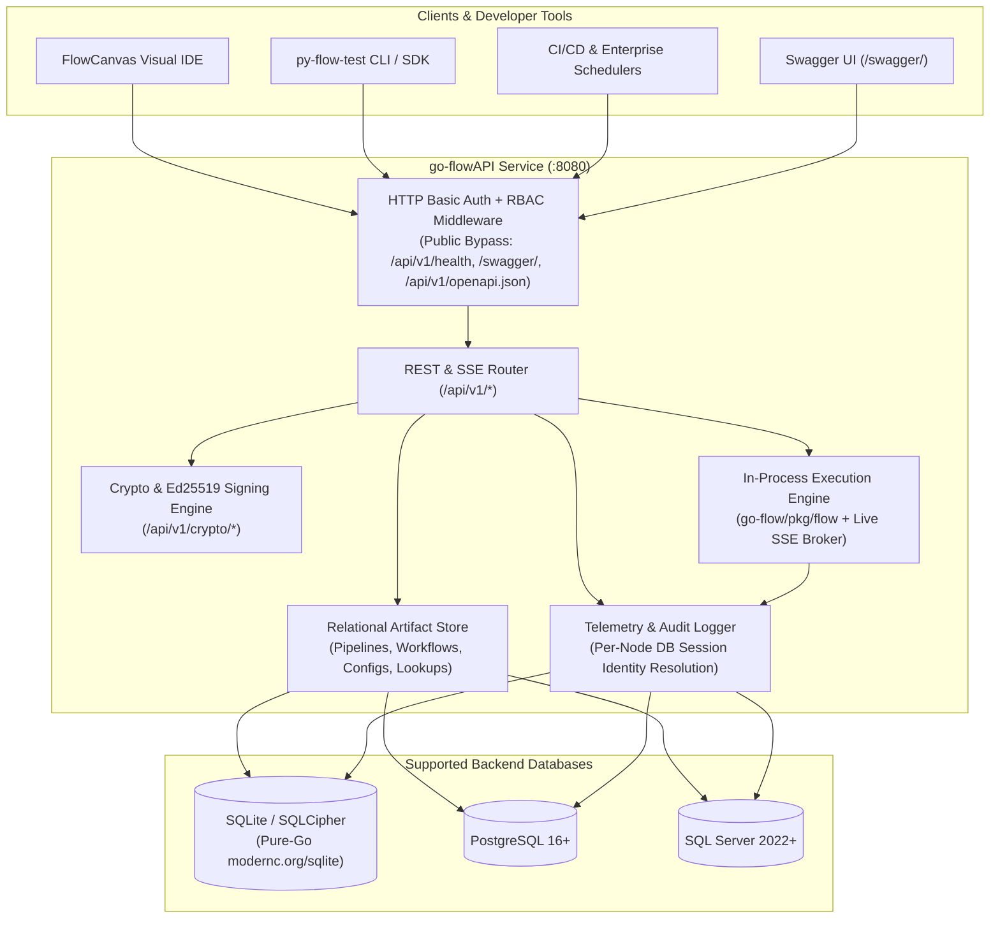
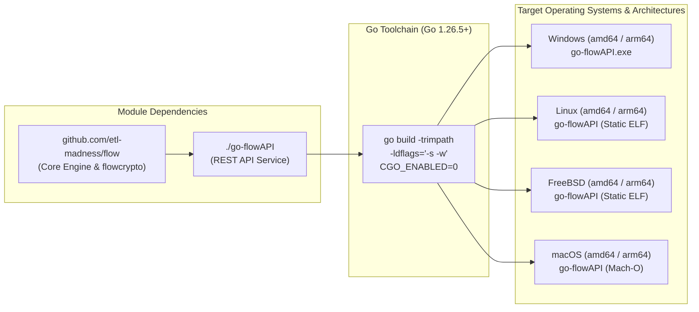
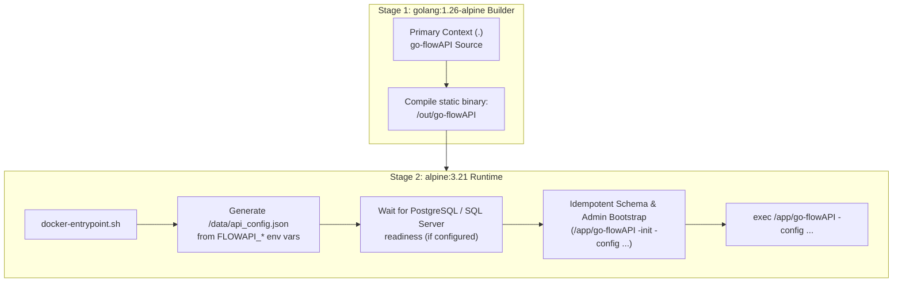
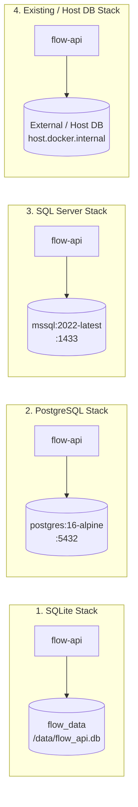
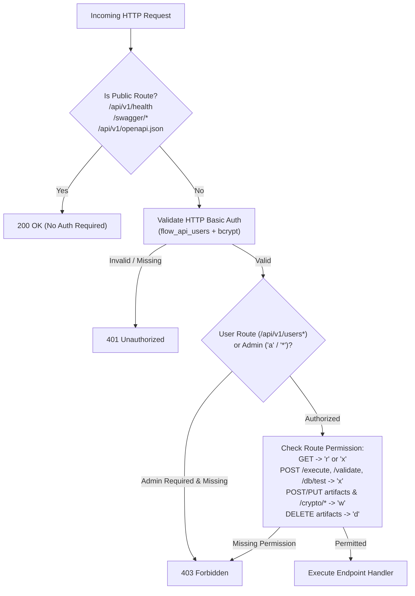
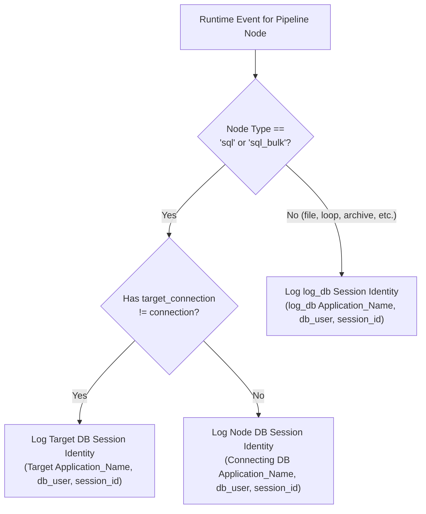

# go-flowAPI — Enterprise Orchestration & Execution Service

`go-flowAPI` is the centralized REST API, artifact repository, live Server-Sent Events (SSE) execution gateway, and multi-database telemetry hub for the **[Flow Ecosystem](https://etl-madness.github.io/flow-docs/)**. It wraps the `go-flow` ETL engine directly in-process via Go modules and provides a unified control plane for `FlowCanvas`, `py-flow-test`, CI/CD pipelines, and enterprise schedulers.

---

## Documentation Navigation

This documentation suite is organized for direct inclusion in the **[Flow Ecosystem Documentation (`flow-docs`)](https://etl-madness.github.io/flow-docs/)**:

| Document | Focus Area |
| :--- | :--- |
| **[`index.md`](index.md)** *(This Document)* | Unified overview of architecture, cross-platform builds, Docker deployment, and all REST API endpoints. |
| **[`COMPILATION_AND_BUILD_GUIDE.md`](COMPILATION_AND_BUILD_GUIDE.md)** | Deep-dive cross-platform compilation options for **Windows**, **Linux**, **FreeBSD**, and **macOS** (`amd64` & `arm64`), compiler flags, static linking, air-gapped vendor builds, and release scripts. |
| **[`DOCKER_DEPLOYMENT_GUIDE.md`](DOCKER_DEPLOYMENT_GUIDE.md)** | Detailed **Docker & Docker Compose** guide covering multi-stage BuildKit contexts, all 4 Compose topologies (SQLite, PostgreSQL 16, SQL Server 2022, Existing/Host DB), Windows SQL Server host networking, and standalone CLI usage. |
| **[`AD_KERBEROS_SIDECAR_GUIDE.md`](AD_KERBEROS_SIDECAR_GUIDE.md)** | Complete guide to running `go-flowAPI` in a Linux container with an **Active Directory Kerberos (`klist`) sidecar**, shared `tmpfs` ticket cache, and nested AD group RBAC resolution. |
| **[`AD_KERBEROS_CONNECTION_FIX.md`](AD_KERBEROS_CONNECTION_FIX.md)** | Diagnosis, changes, and verification for the SQL Server Kerberos connection fix. |
| **[`API_ENDPOINTS_REFERENCE.md`](API_ENDPOINTS_REFERENCE.md)** | Exhaustive **REST API Endpoint Reference** covering authentication, RBAC permission matrix, request/response schemas, SSE live streaming, cryptographic utilities, telemetry queries, and per-node database session identity logging. |

---

## High-Level Ecosystem Architecture



---

## 1. Cross-Platform Compile Options (Windows, Linux, FreeBSD, macOS)

> **Full Guide:** See **[Cross-Platform Compilation & Build Guide](COMPILATION_AND_BUILD_GUIDE.md)** for complete build scripts, air-gapped vendor packaging, and platform verification steps.

Because `go-flowAPI` and `flow` use **100% pure-Go database drivers** (`modernc.org/sqlite`, `lib/pq`, `go-sql-driver/mysql`, `sijms/go-ora/v2`, and `microsoft/go-mssqldb`), `go-flowAPI` compiles into a **single zero-dependency static binary** (`CGO_ENABLED=0`) from any host OS targeting **Windows**, **Linux**, **FreeBSD**, and **macOS** across `amd64` and `arm64`.



### Target Matrix & Build Variables

| Operating System | `GOOS` | `GOARCH` Options | `CGO_ENABLED` | Output Binary Name |
| :--- | :--- | :--- | :---: | :--- |
| **Windows** | `windows` | `amd64`, `arm64` | `0` | `go-flowAPI-windows-<arch>.exe` |
| **Linux** | `linux` | `amd64`, `arm64` | `0` | `go-flowAPI-linux-<arch>` |
| **FreeBSD** | `freebsd` | `amd64`, `arm64` | `0` | `go-flowAPI-freebsd-<arch>` |
| **macOS (Darwin)** | `darwin` | `amd64`, `arm64` | `0` | `go-flowAPI-darwin-<arch>` |

### Quick Build Commands (PowerShell — Windows Host)

```powershell
# 1. Windows (amd64 & arm64)
$env:CGO_ENABLED="0"; $env:GOOS="windows"; $env:GOARCH="amd64"
go build -trimpath -ldflags="-s -w" -o dist/go-flowAPI-windows-amd64.exe .

$env:CGO_ENABLED="0"; $env:GOOS="windows"; $env:GOARCH="arm64"
go build -trimpath -ldflags="-s -w" -o dist/go-flowAPI-windows-arm64.exe .

# 2. Linux (amd64 & arm64)
$env:CGO_ENABLED="0"; $env:GOOS="linux"; $env:GOARCH="amd64"
go build -trimpath -ldflags="-s -w" -o dist/go-flowAPI-linux-amd64 .

$env:CGO_ENABLED="0"; $env:GOOS="linux"; $env:GOARCH="arm64"
go build -trimpath -ldflags="-s -w" -o dist/go-flowAPI-linux-arm64 .

# 3. FreeBSD (amd64 & arm64)
$env:CGO_ENABLED="0"; $env:GOOS="freebsd"; $env:GOARCH="amd64"
go build -trimpath -ldflags="-s -w" -o dist/go-flowAPI-freebsd-amd64 .

$env:CGO_ENABLED="0"; $env:GOOS="freebsd"; $env:GOARCH="arm64"
go build -trimpath -ldflags="-s -w" -o dist/go-flowAPI-freebsd-arm64 .

# 4. macOS / Darwin (Intel amd64 & Apple Silicon arm64)
$env:CGO_ENABLED="0"; $env:GOOS="darwin"; $env:GOARCH="amd64"
go build -trimpath -ldflags="-s -w" -o dist/go-flowAPI-darwin-amd64 .

$env:CGO_ENABLED="0"; $env:GOOS="darwin"; $env:GOARCH="arm64"
go build -trimpath -ldflags="-s -w" -o dist/go-flowAPI-darwin-arm64 .

# Reset environment variables
Remove-Item Env:\CGO_ENABLED, Env:\GOOS, Env:\GOARCH -ErrorAction SilentlyContinue
```

### Quick Build Commands (Bash / Zsh — Linux, FreeBSD, macOS Host)

```bash
mkdir -p dist

# Windows
CGO_ENABLED=0 GOOS=windows GOARCH=amd64 go build -trimpath -ldflags="-s -w" -o dist/go-flowAPI-windows-amd64.exe .
CGO_ENABLED=0 GOOS=windows GOARCH=arm64 go build -trimpath -ldflags="-s -w" -o dist/go-flowAPI-windows-arm64.exe .

# Linux
CGO_ENABLED=0 GOOS=linux GOARCH=amd64   go build -trimpath -ldflags="-s -w" -o dist/go-flowAPI-linux-amd64 .
CGO_ENABLED=0 GOOS=linux GOARCH=arm64   go build -trimpath -ldflags="-s -w" -o dist/go-flowAPI-linux-arm64 .

# FreeBSD
CGO_ENABLED=0 GOOS=freebsd GOARCH=amd64 go build -trimpath -ldflags="-s -w" -o dist/go-flowAPI-freebsd-amd64 .
CGO_ENABLED=0 GOOS=freebsd GOARCH=arm64 go build -trimpath -ldflags="-s -w" -o dist/go-flowAPI-freebsd-arm64 .

# macOS (Intel & Apple Silicon)
CGO_ENABLED=0 GOOS=darwin GOARCH=amd64  go build -trimpath -ldflags="-s -w" -o dist/go-flowAPI-darwin-amd64 .
CGO_ENABLED=0 GOOS=darwin GOARCH=arm64  go build -trimpath -ldflags="-s -w" -o dist/go-flowAPI-darwin-arm64 .
```

---

## 2. Detailed Docker Instructions

> **Full Guide:** See **[Docker & Container Deployment Guide](DOCKER_DEPLOYMENT_GUIDE.md)** for full BuildKit context details, environment variable reference, Windows SQL Server host networking, and troubleshooting.

### Multi-Stage Docker Build Architecture & Entrypoint Flow

The [`Dockerfile`](../Dockerfile) uses a clean two-stage build to compile `go-flowAPI` inside a `golang:1.26-alpine` builder stage (`CGO_ENABLED=0`) and copy the static binary into a minimal `alpine:3.21` runtime image.



### The 4 Docker Compose Deployment Topologies

| Compose File | Database Architecture | Launch Command |
| :--- | :--- | :--- |
| **[`docker-compose.yml`](../docker-compose.yml)** | **Embedded SQLite** (`flow_data` volume at `/data/flow_api.db`) | `docker compose up -d --build` |
| **[`docker-compose.postgres.yml`](../docker-compose.postgres.yml)** | **PostgreSQL 16 Container** (`postgres:16-alpine` + `flow-api`) | `docker compose -f docker-compose.postgres.yml up -d --build` |
| **[`docker-compose.sqlserver.yml`](../docker-compose.sqlserver.yml)** | **SQL Server 2022 Container** (`mcr.microsoft.com/mssql/server:2022-latest` + `mssql-init` + `flow-api`) | `docker compose -f docker-compose.sqlserver.yml up -d --build` |
| **[`docker-compose.existing-db.yml`](../docker-compose.existing-db.yml)** | **Existing / External Database** (`flow-api` only; connects to host or remote DB via `host.docker.internal` or IP/FQDN) | `docker compose -f docker-compose.existing-db.yml up -d --build` |



### Standalone `docker build` & `docker run`

When building directly with `docker build` (outside Docker Compose):

```bash
# Build image
docker build -t go-flowapi:latest .

# Run with embedded SQLite
docker run -d \
  --name flow-api \
  -p 8080:8080 \
  -v flow_data:/data \
  -e FLOWAPI_ADMIN_USER=admin \
  -e FLOWAPI_ADMIN_PASSWORD=changeme \
  go-flowapi:latest
```

---

## 3. Overview of Each API Endpoint

> **Full Guide:** See **[API Endpoints Reference](API_ENDPOINTS_REFERENCE.md)** for full request/response payloads, curl examples, SSE event schemas, and telemetry details.

### Authentication & Role-Based Access Control (RBAC)

- **Public Endpoints (No Auth Required):**
  - `GET /api/v1/health`
  - `GET /swagger/`, `GET /docs`, `GET /api/v1/openapi.json`
- **Protected Endpoints (HTTP Basic Auth Required):**
  - Every other `/api/v1/*` route enforces HTTP Basic Authentication and checks the authenticated user's `permissions` string (`r` = Read, `w` = Write, `x` = Execute, `d` = Delete, `a` = Admin, `*` = Full Access).
  - **Execution-Only (`x`) Implicit Read Access:** Users granted `x` automatically receive read access to `GET` endpoints so `FlowCanvas` and CLI runners can fetch artifacts to execute them.



### Complete Endpoint Summary Table

#### A. Public Documentation & Health Endpoints

| Method | Path | Auth | Description |
| :---: | :--- | :---: | :--- |
| `GET` | `/api/v1/health` | **None (Public)** | Liveness & database connectivity probe (`status`, `version`, `db_provider`, `time`). |
| `GET` | `/swagger/` | **None (Public)** | Interactive Swagger UI browser explorer (alias: `/docs`). |
| `GET` | `/api/v1/openapi.json` | **None (Public)** | OpenAPI 3.0.3 JSON specification. |

#### B. Artifact Upload & CRUD Endpoints (`{type}`: `config`, `pipeline`, `workflow`, `lookup`)

| Method | Path | Auth / Perm | Description |
| :---: | :--- | :---: | :--- |
| `POST` | `/api/v1/upload/{type}` | `w` | Upload a raw JSON artifact (`?name=...` optional) and persist to `api_db`. |
| `GET` | `/api/v1/artifacts/{type}` | `r` or `x` | List metadata for all active artifacts of `{type}`. |
| `GET` | `/api/v1/artifacts/{type}/{name}` | `r` or `x` | Fetch full artifact record + raw JSON by logical name (`?version=N` optional). |
| `PUT` | `/api/v1/artifacts/{type}/{name}` | `w` | Update existing artifact in-place by logical name. |
| `DELETE` | `/api/v1/artifacts/{type}/{name}` | `d` | Soft-delete (`?hard=false`) or permanently delete (`?hard=true`) by name. |
| `GET` | `/api/v1/artifacts/{type}/{name}/export` | `r` or `x` | Download raw artifact JSON as a file attachment by name. |
| `GET` | `/api/v1/artifacts/{type}/id/{id}` | `r` or `x` | Fetch full artifact record by primary key ID. |
| `PUT` | `/api/v1/artifacts/{type}/id/{id}` | `w` | Update existing artifact in-place by primary key ID (`?name=...` optional). |
| `DELETE` | `/api/v1/artifacts/{type}/id/{id}` | `d` | Soft-delete or hard-delete artifact by primary key ID. |
| `GET` | `/api/v1/artifacts/{type}/id/{id}/export` | `r` or `x` | Download raw artifact JSON as a file attachment by primary key ID. |

#### C. Execution, Live SSE Streaming & Validation Endpoints

| Method | Path | Auth / Perm | Description |
| :---: | :--- | :---: | :--- |
| `POST` | `/api/v1/execute` | `x` | Synchronously execute a pipeline or workflow by body payload (`target_type`, `target_name`, `config_name`, `inline_json`, `step_id`, `batch_size`, `verbose`). |
| `POST` | `/api/v1/execute/{type}/{id}` | `x` | Synchronously execute a stored `pipeline` or `workflow` by database table ID (`?config_id=...&step_id=...`). |
| `POST` | `/api/v1/execute/stream` | `x` | Execute and stream real-time Server-Sent Events (`text/event-stream`: `start`, `log`, `event`, `result`, `error`). |
| `POST` | `/api/v1/execute/stream/{type}/{id}` | `x` | Execute stored artifact by database ID and stream real-time SSE progress. |
| `POST` | `/api/v1/validate` | `x` | Validate DAG structure, step references, and config bindings without executing. |
| `POST` | `/api/v1/validate/{type}/{id}` | `x` | Validate a stored `pipeline` or `workflow` by database ID. |

#### D. Cryptographic & Digital Signature Endpoints

| Method | Path | Auth / Perm | Description |
| :---: | :--- | :---: | :--- |
| `POST` | `/api/v1/crypto/keygen` | `w` | Generate a new AES-256-GCM encryption key (`purpose: "encryption"`) or Ed25519 keypair (`purpose: "signing"`). |
| `POST` | `/api/v1/crypto/encrypt` | `w` | Encrypt plaintext into a `ENC:GCM:...` token or encrypt all sensitive fields in a config JSON (`mode: "config"`). |
| `POST` | `/api/v1/crypto/decrypt` | `w` | Decrypt an `ENC:GCM:...` token or decrypt all encrypted fields in a config JSON. |
| `POST` | `/api/v1/crypto/sign` | `w` | Digitally sign a pipeline, workflow, or config JSON using an Ed25519 private key. |
| `POST` | `/api/v1/crypto/verify` | `r` or `x` | Verify the Ed25519 digital signature embedded in an artifact JSON using an Ed25519 public key. |

#### E. Telemetry, Execution History & Audit Log Endpoints

| Method | Path | Auth / Perm | Description |
| :---: | :--- | :---: | :--- |
| `GET` | `/api/v1/runs` | `r` or `x` | Query `flow_execution_runs` (`?limit=50&run_type=pipeline&status=SUCCESS`). Alias: `/api/v1/logs/runs`. |
| `GET` | `/api/v1/events` | `r` or `x` | Query step-level `flow_Runtime_Events` (`?run_id=...&limit=100`). Alias: `/api/v1/logs/events`. |
| `GET` | `/api/v1/audit` | `r` or `x` | Query `flow_api_audit_logs` (`?limit=100`). Alias: `/api/v1/logs/audit`. |

#### F. Database Connectivity Test & User Management Endpoints

| Method | Path | Auth / Perm | Description |
| :---: | :--- | :---: | :--- |
| `POST` | `/api/v1/db/test` | `x` | Test live connectivity to a database (`provider` + `connection_string` or `config_name`/`config_id` + `connection_name`). |
| `GET` | `/api/v1/users` | `a` | List all registered API users and their RBAC permission strings. |
| `POST` | `/api/v1/users` | `a` | Create or update an API user (`username`, `password`, `permissions`, `is_active`). |
| `DELETE` | `/api/v1/users/{username}` | `a` | Delete an API user account. |

---

### Per-Node Database Session Identity in Telemetry (`flow_Runtime_Events`)

When `go-flowAPI` logs step-level events to `flow_Runtime_Events`, it dynamically resolves `db_user`, `client_net_address`, `Application_Name`, and `session_id` per pipeline node to match the CLI `go-flow` executable:


