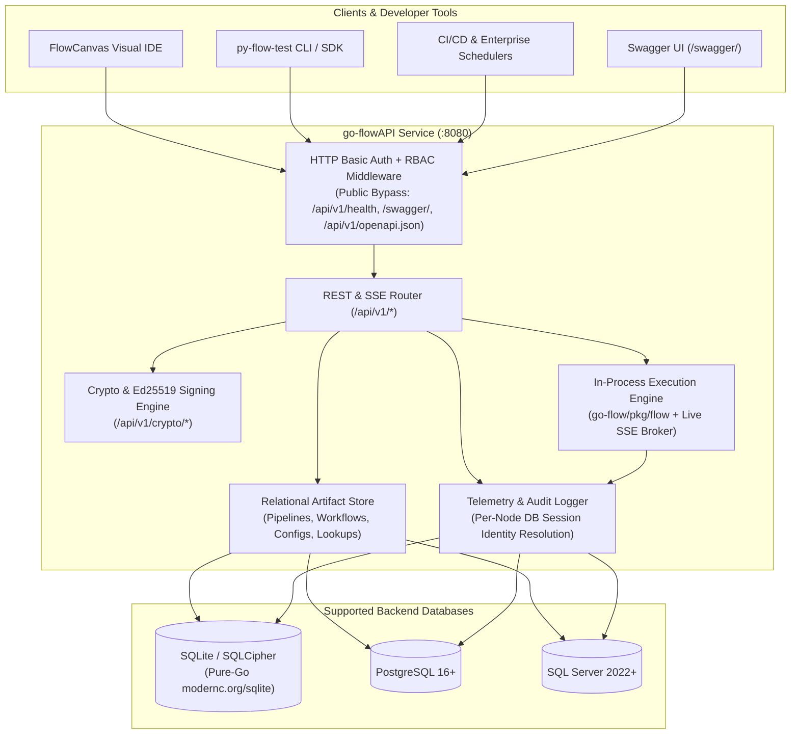
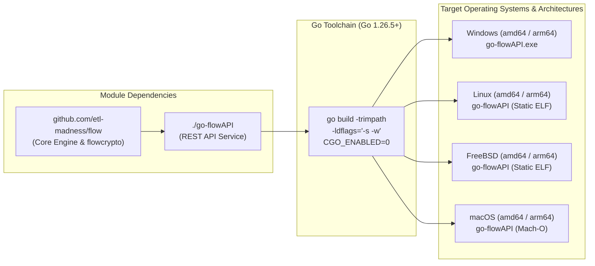
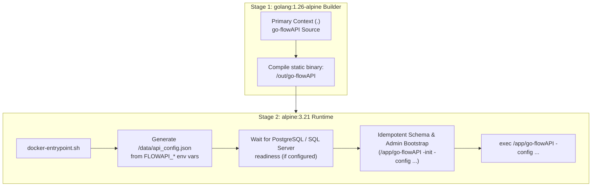
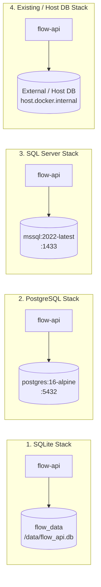
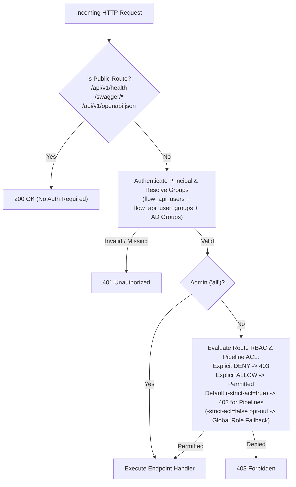
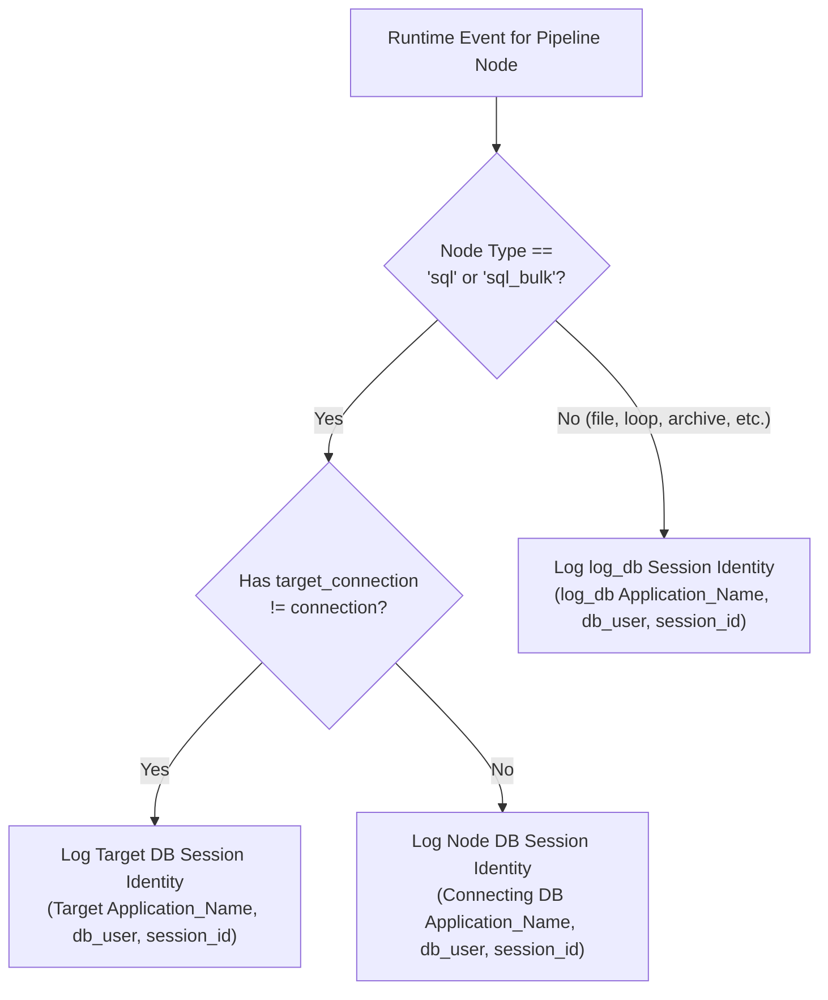

# go-flowAPI — Enterprise Orchestration & Execution Service (`v1.3.2`)

> **Version:** `1.3.2` | **Companion Studio UI:** `FlowUI v1.3.1`

`go-flowAPI` is the centralized REST API, artifact repository, live Server-Sent Events (SSE) execution gateway, granular pipeline ACL engine, and multi-database telemetry hub for the **[Flow Ecosystem](https://etl-madness.github.io/flow-docs/)**. It wraps the `go-flow` ETL engine directly in-process via Go modules and provides a unified control plane for `FlowUI`, `FlowCanvas`, `py-flow-test`, CI/CD pipelines, and enterprise schedulers.

---

## Documentation Navigation

This documentation suite is organized for direct inclusion in the **[Flow Ecosystem Documentation (`flow-docs`)](https://etl-madness.github.io/flow-docs/)**:

| Document | Focus Area |
| :--- | :--- |
| **[`index.md`](index.md)** *(This Document)* | Unified overview of architecture, cross-platform builds, Docker deployment, and all REST API endpoints. |
| **[`API_COMPILATION_AND_BUILD_GUIDE.md`](API_COMPILATION_AND_BUILD_GUIDE.md)** | Deep-dive cross-platform compilation options for **Windows**, **Linux**, **FreeBSD**, and **macOS** (`amd64` & `arm64`), compiler flags, static linking, air-gapped vendor builds, and release scripts. |
| **[`API_DOCKER_DEPLOYMENT_GUIDE.md`](API_DOCKER_DEPLOYMENT_GUIDE.md)** | Detailed **Docker & Docker Compose** guide covering multi-stage BuildKit contexts, all 4 Compose topologies (SQLite, PostgreSQL 16, SQL Server 2022, Existing/Host DB), Windows SQL Server host networking, and standalone CLI usage. |
| **[`AD_KERBEROS_SIDECAR_GUIDE.md`](AD_KERBEROS_SIDECAR_GUIDE.md)** | Complete guide to running `go-flowAPI` in a Linux container with an **Active Directory Kerberos (`klist`) sidecar**, shared `tmpfs` ticket cache, and nested AD group RBAC resolution. |
| **[`AD_KERBEROS_CONNECTION_FIX.md`](AD_KERBEROS_CONNECTION_FIX.md)** | Diagnosis, changes, and verification for the SQL Server Kerberos connection fix. |
| **[`API_ENDPOINTS_REFERENCE.md`](API_ENDPOINTS_REFERENCE.md)** | Exhaustive **REST API Endpoint Reference** covering authentication, global RBAC & granular pipeline ACLs, request/response schemas, SSE live streaming, cryptographic utilities, telemetry queries, and per-node database session identity logging. |

---

## High-Level Ecosystem Architecture



---

## 1. Cross-Platform Compile Options (Windows, Linux, FreeBSD, macOS)

> **Full Guide:** See **[Cross-Platform Compilation & Build Guide](API_COMPILATION_AND_BUILD_GUIDE.md)** for complete build scripts, air-gapped vendor packaging, and platform verification steps.

Because `go-flowAPI` and `flow` use **100% pure-Go database drivers** (`modernc.org/sqlite`, `lib/pq`, `go-sql-driver/mysql`, `sijms/go-ora/v2`, and `microsoft/go-mssqldb`), `go-flowAPI` compiles into a **single zero-dependency static binary** (`CGO_ENABLED=0`) from any host OS targeting **Windows**, **Linux**, **FreeBSD**, and **macOS** across `amd64` and `arm64`.



### Target Matrix & Build Variables

| Operating System | `GOOS` | `GOARCH` Options | `CGO_ENABLED` | Output Binary Name |
| :--- | :--- | :--- | :---: | :--- |
| **Windows** | `windows` | `amd64`, `arm64` | `0` | `go-flowAPI-windows-<arch>.exe` |
| **Linux** | `linux` | `amd64`, `arm64` | `0` | `go-flowAPI-linux-<arch>` |
| **FreeBSD** | `freebsd` | `amd64`, `arm64` | `0` | `go-flowAPI-freebsd-<arch>` |
| **macOS (Darwin)** | `darwin` | `amd64`, `arm64` | `0` | `go-flowAPI-darwin-<arch>` |

### Quick Build Commands (PowerShell — Windows Host)

```powershell
# 1. Windows (amd64 & arm64)
$env:CGO_ENABLED="0"; $env:GOOS="windows"; $env:GOARCH="amd64"
go build -trimpath -ldflags="-s -w" -o dist/go-flowAPI-windows-amd64.exe .

$env:CGO_ENABLED="0"; $env:GOOS="windows"; $env:GOARCH="arm64"
go build -trimpath -ldflags="-s -w" -o dist/go-flowAPI-windows-arm64.exe .

# 2. Linux (amd64 & arm64)
$env:CGO_ENABLED="0"; $env:GOOS="linux"; $env:GOARCH="amd64"
go build -trimpath -ldflags="-s -w" -o dist/go-flowAPI-linux-amd64 .

$env:CGO_ENABLED="0"; $env:GOOS="linux"; $env:GOARCH="arm64"
go build -trimpath -ldflags="-s -w" -o dist/go-flowAPI-linux-arm64 .

# 3. FreeBSD (amd64 & arm64)
$env:CGO_ENABLED="0"; $env:GOOS="freebsd"; $env:GOARCH="amd64"
go build -trimpath -ldflags="-s -w" -o dist/go-flowAPI-freebsd-amd64 .

$env:CGO_ENABLED="0"; $env:GOOS="freebsd"; $env:GOARCH="arm64"
go build -trimpath -ldflags="-s -w" -o dist/go-flowAPI-freebsd-arm64 .

# 4. macOS / Darwin (Intel amd64 & Apple Silicon arm64)
$env:CGO_ENABLED="0"; $env:GOOS="darwin"; $env:GOARCH="amd64"
go build -trimpath -ldflags="-s -w" -o dist/go-flowAPI-darwin-amd64 .

$env:CGO_ENABLED="0"; $env:GOOS="darwin"; $env:GOARCH="arm64"
go build -trimpath -ldflags="-s -w" -o dist/go-flowAPI-darwin-arm64 .

# Reset environment variables
Remove-Item Env:\CGO_ENABLED, Env:\GOOS, Env:\GOARCH -ErrorAction SilentlyContinue
```

### Quick Build Commands (Bash / Zsh — Linux, FreeBSD, macOS Host)

```bash
mkdir -p dist

# Windows
CGO_ENABLED=0 GOOS=windows GOARCH=amd64 go build -trimpath -ldflags="-s -w" -o dist/go-flowAPI-windows-amd64.exe .
CGO_ENABLED=0 GOOS=windows GOARCH=arm64 go build -trimpath -ldflags="-s -w" -o dist/go-flowAPI-windows-arm64.exe .

# Linux
CGO_ENABLED=0 GOOS=linux GOARCH=amd64   go build -trimpath -ldflags="-s -w" -o dist/go-flowAPI-linux-amd64 .
CGO_ENABLED=0 GOOS=linux GOARCH=arm64   go build -trimpath -ldflags="-s -w" -o dist/go-flowAPI-linux-arm64 .

# FreeBSD
CGO_ENABLED=0 GOOS=freebsd GOARCH=amd64 go build -trimpath -ldflags="-s -w" -o dist/go-flowAPI-freebsd-amd64 .
CGO_ENABLED=0 GOOS=freebsd GOARCH=arm64 go build -trimpath -ldflags="-s -w" -o dist/go-flowAPI-freebsd-arm64 .

# macOS (Intel & Apple Silicon)
CGO_ENABLED=0 GOOS=darwin GOARCH=amd64  go build -trimpath -ldflags="-s -w" -o dist/go-flowAPI-darwin-amd64 .
CGO_ENABLED=0 GOOS=darwin GOARCH=arm64  go build -trimpath -ldflags="-s -w" -o dist/go-flowAPI-darwin-arm64 .
```

---

## 2. Detailed Docker Instructions

> **Full Guide:** See **[Docker & Container Deployment Guide](API_DOCKER_DEPLOYMENT_GUIDE.md)** for full BuildKit context details, environment variable reference, Windows SQL Server host networking, and troubleshooting.

### Multi-Stage Docker Build Architecture & Entrypoint Flow

The [`Dockerfile`](../Dockerfile) uses a clean two-stage build to compile `go-flowAPI` inside a `golang:1.26-alpine` builder stage (`CGO_ENABLED=0`) and copy the static binary into a minimal `alpine:3.21` runtime image.



### The 4 Docker Compose Deployment Topologies

| Compose File | Database Architecture | Launch Command |
| :--- | :--- | :--- |
| **[`docker-compose.yml`](../docker-compose.yml)** | **Embedded SQLite** (`flow_data` volume at `/data/flow_api.db`) | `docker compose up -d --build` |
| **[`docker-compose.postgres.yml`](../docker-compose.postgres.yml)** | **PostgreSQL 16 Container** (`postgres:16-alpine` + `flow-api`) | `docker compose -f docker-compose.postgres.yml up -d --build` |
| **[`docker-compose.sqlserver.yml`](../docker-compose.sqlserver.yml)** | **SQL Server 2022 Container** (`mcr.microsoft.com/mssql/server:2022-latest` + `mssql-init` + `flow-api`) | `docker compose -f docker-compose.sqlserver.yml up -d --build` |
| **[`docker-compose.existing-db.yml`](../docker-compose.existing-db.yml)** | **Existing / External Database** (`flow-api` only; connects to host or remote DB via `host.docker.internal` or IP/FQDN) | `docker compose -f docker-compose.existing-db.yml up -d --build` |



### Standalone `docker build` & `docker run`

When building directly with `docker build` (outside Docker Compose):

```bash
# Build image
docker build -t go-flowapi:latest .

# Run with embedded SQLite
docker run -d \
  --name flow-api \
  -p 8080:8080 \
  -v flow_data:/data \
  -e FLOWAPI_ADMIN_USER=admin \
  -e FLOWAPI_ADMIN_PASSWORD=changeme \
  go-flowapi:latest
```

---

## 3. Overview of Each API Endpoint

> **Full Guide:** See **[API Endpoints Reference](API_ENDPOINTS_REFERENCE.md)** for full request/response payloads, curl examples, SSE event schemas, granular ACL rules, and telemetry details.

### Authentication, Global RBAC & Granular Pipeline ACLs

- **Public Endpoints (No Auth Required):**
  - `GET /api/v1/health` *(optional BasicAuth populates `authenticated_as`, `permission`, and `groups`)*
  - `GET /swagger/`, `GET /docs`, `GET /api/v1/openapi.json`
- **Protected Endpoints (HTTP BasicAuth + Windows/AD Group Resolution):**
  - Every other `/api/v1/*` route authenticates against `dbo.flow_api_users`, resolves API group memberships (`dbo.flow_api_user_groups`) and Windows/AD groups (`X-Flow-Windows-Groups`), and evaluates:
    1. **`all` administrator role** → full access across all endpoints.
    2. **Explicit `deny` rule in `dbo.flow_pipeline_acl`** → blocks matching pipeline actions (`403 Forbidden`).
    3. **Explicit `allow` rule in `dbo.flow_pipeline_acl`** → grants `create`, `read`, `update`, `delete`, `execute`, or `all` on a `pipeline`, `pipeline_group` (explicit members + `name_pattern` glob), or `*`.
    4. **Default Deny for Pipelines (`-strict-acl=true` default)** → non-admin accounts without matching `allow` rules in `dbo.flow_pipeline_acl` have **zero pipeline access** (`403 Forbidden`). Global roles (`read-only`, `execution-only`, `write` / `upload`) govern non-pipeline endpoints (`config`, `options`, `crypto`, `audit`) and only fall back to pipelines if `-strict-acl=false` (`FLOW_API_STRICT_ACL=false`) is explicitly enabled and the user's role is not `scoped`.



### Complete Endpoint Summary Table

#### A. Public Documentation & Health Endpoints

| Method | Path | Auth | Description |
| :---: | :--- | :---: | :--- |
| `GET` | `/api/v1/health` | **Public** *(Optional Auth)* | Liveness, DB session identity (`dialect`, `db_spid`, `db_user`), caller `groups`, and configured tables. |
| `GET` | `/swagger/` | **Public** | Interactive Swagger UI browser explorer (alias: `/docs`). |
| `GET` | `/api/v1/openapi.json` | **Public** | OpenAPI 3.0.3 JSON specification. |

#### B. Artifact Upload & CRUD Endpoints (`{type}`: `pipeline`, `options`, `config`)

| Method | Path | Auth / Perm | Description |
| :---: | :--- | :---: | :--- |
| `POST`, `PUT` | `/api/v1/upload/{type}` | `write`, `upload`, `all`, or ACL (`create`/`update`) | Upload `.xml`/`.json` file (`multipart/form-data` or raw body; supports optional `group` for pipelines). |
| `GET` | `/api/v1/artifacts/{type}` | `read-only`+ or ACL (`read`) | List artifacts of `{type}`; filters `pipeline` results to readable pipelines and returns `groups`. |
| `POST` | `/api/v1/artifacts/{type}` | `write`, `upload`, `all`, or ACL (`create`/`update`) | Create or upsert (`upsert=true`) an artifact; supports `"groups": [...]` for pipelines. |
| `GET` | `/api/v1/artifacts/{type}/{name}` | `read-only`+ or ACL (`read`) | Fetch full artifact record by unique `name` (`?decrypt=true` supported). |
| `PUT` | `/api/v1/artifacts/{type}/{name}` | `write`, `upload`, `all`, or ACL (`update`) | Update existing artifact in-place by unique `name`. |
| `DELETE` | `/api/v1/artifacts/{type}/{name}` | `write`, `upload`, `all`, or ACL (`delete`) | Delete artifact by `name` (cleans up pipeline group memberships and direct ACLs). |
| `GET` | `/api/v1/artifacts/{type}/{name}/export` | `read-only`+ or ACL (`read`) | Download raw XML artifact as a file attachment by `name`. |
| `GET` | `/api/v1/artifacts/{type}/id/{id}` | `read-only`+ or ACL (`read`) | Fetch full artifact record by primary key `ID`. |
| `PUT` | `/api/v1/artifacts/{type}/id/{id}` | `write`, `upload`, `all`, or ACL (`update`) | Update existing artifact in-place by primary key `ID`. |
| `DELETE` | `/api/v1/artifacts/{type}/id/{id}` | `write`, `upload`, `all`, or ACL (`delete`) | Delete artifact by primary key `ID`. |
| `GET` | `/api/v1/artifacts/{type}/id/{id}/export` | `read-only`+ or ACL (`read`) | Download raw XML artifact as a file attachment by primary key `ID`. |

#### C. Execution, Live SSE Streaming & Validation Endpoints

| Method | Path | Auth / Perm | Description |
| :---: | :--- | :---: | :--- |
| `POST` | `/api/v1/execute` | `execution-only`, `all`, or ACL (`execute`) | Synchronously execute a pipeline with full CLI/Builder parity (`file`, `file_xml`, `config`, `options`, `vars`, `node_output`). |
| `POST` | `/api/v1/execute/{type}/{id}` | `execution-only`, `all`, or ACL (`execute`) | Synchronously execute a stored `pipeline`, `options`, or `config` artifact by database table `ID`. |
| `POST`, `GET` | `/api/v1/execute/stream` | `execution-only`, `all`, or ACL (`execute`) | Execute and stream real-time Server-Sent Events (`text/event-stream`: `event: node_event`, `event: done`). |
| `POST`, `GET` | `/api/v1/execute/stream/{type}/{id}` | `execution-only`, `all`, or ACL (`execute`) | Execute stored artifact by database `ID` and stream real-time SSE progress. |
| `POST` | `/api/v1/validate` | `execution-only`, `all`, or ACL (`execute`) | Validate XSD compliance and AST semantic rules without executing `<flow>` steps. |
| `POST` | `/api/v1/validate/{type}/{id}` | `execution-only`, `all`, or ACL (`execute`) | Validate a stored artifact by `{type}` and database `ID`. |

#### D. Cryptographic & Digital Signature Endpoints

| Method | Path | Auth / Perm | Description |
| :---: | :--- | :---: | :--- |
| `POST` | `/api/v1/crypto/keygen` | `read-only`+ | Generate AES-256 keys, RSA-2048/4096, ECDSA-P256/P384, Ed25519 (+ X.509 cert), or OpenPGP keypairs. |
| `POST` | `/api/v1/crypto/encrypt` | `read-only`+ | Encrypt XML/text into a `FLOWENC:v1:` AES-256-GCM armored envelope. |
| `POST` | `/api/v1/crypto/decrypt` | `read-only`+ | Decrypt a `FLOWENC:v1:` envelope and inspect inner signature status. |
| `POST` | `/api/v1/crypto/sign` | `read-only`+ | Digitally sign XML payloads using `OPENSSL`, `PKCS7`, or `PGP` (`none`, `sign-then-encrypt`, `encrypt-then-sign`). |
| `POST` | `/api/v1/crypto/verify` | `read-only`+ | Verify wrapped (`FLOWSIGNED:v1:`) or detached signatures and X.509 chains. |

#### E. Telemetry, Execution History & Audit Log Endpoints

| Method | Path | Auth / Perm | Description |
| :---: | :--- | :---: | :--- |
| `GET` | `/api/v1/runs` | `read-only`+ | Query `dbo.pipeline_runs` (`?limit=100&status=...`). Alias: `/api/v1/logs/runs`. |
| `GET` | `/api/v1/events` | `read-only`+ | Query step-level `dbo.pipeline_events` (`?run_id=...&limit=200`). Alias: `/api/v1/logs/events`. |
| `GET` | `/api/v1/audit` | `read-only`+ | Query `dbo.flow_api_events` (`?limit=200&status=...`). Alias: `/api/v1/logs/api-events`. |

#### F. Database Connectivity Test & User Management Endpoints

| Method | Path | Auth / Perm | Description |
| :---: | :--- | :---: | :--- |
| `POST` | `/api/v1/db/test` | `all` | Test live connectivity to the startup DB or a custom `dsn` (`sqlserver`, `postgres`, `mysql`, `sqlite`, `oracle`). |
| `GET` | `/api/v1/users` | `all` | List all registered API users, permission scopes (`all`, `scoped`, `write`, `upload`, `execution-only`, `read-only`), and `groups`. |
| `POST` | `/api/v1/users` | `all` | Create or update an API user (`username`, `password`, `permission`, `is_active`, `groups`). |
| `DELETE` | `/api/v1/users/{username}` | `all` | Delete an API user account and clean up group memberships/direct ACLs. |

#### G. Granular Pipeline ACLs, User Groups, Pipeline Groups & Effective Permissions

| Method | Path | Auth / Perm | Description |
| :---: | :--- | :---: | :--- |
| `GET`, `POST` | `/api/v1/groups` | `all` | List or create/upsert API user groups (`dbo.flow_api_groups`). |
| `GET`, `PUT`, `DELETE` | `/api/v1/groups/{name}` | `all` | Inspect, update, or delete an API user group. |
| `GET`, `POST` | `/api/v1/groups/{name}/members` | `all` | List or add `username` / `usernames` to `dbo.flow_api_user_groups`. |
| `DELETE` | `/api/v1/groups/{name}/members/{username}` | `all` | Remove a user from an API user group. |
| `GET`, `POST` | `/api/v1/pipeline-groups` | `GET`: Auth; `POST`: `all` | List or create/upsert pipeline groups with optional `name_pattern` glob (`dbo.flow_pipeline_groups`). |
| `GET`, `PUT`, `DELETE` | `/api/v1/pipeline-groups/{name}` | `GET`: Auth; `PUT`/`DELETE`: `all` | Inspect, update, or delete a pipeline group. |
| `GET`, `POST` | `/api/v1/pipeline-groups/{name}/pipelines` | `GET`: Auth; `POST`: `all` | List or assign `pipeline_name` / `pipelines` (`dbo.flow_pipeline_group_members`). |
| `DELETE` | `/api/v1/pipeline-groups/{name}/pipelines/{pipeline}` | `all` | Remove an explicit pipeline assignment from a pipeline group. |
| `GET`, `POST` | `/api/v1/acls` | `all` | List (filterable by principal/target) or create/upsert `allow`/`deny` pipeline ACL rules (`dbo.flow_pipeline_acl`). |
| `PUT`, `DELETE` | `/api/v1/acls/{id}` | `all` | Update or delete a granular pipeline ACL rule by primary key `id`. |
| `GET` | `/api/v1/permissions/effective` | Any Auth (`all` for `?username=&groups=`) | Compute effective per-pipeline `create`, `read`, `update`, `delete`, and `execute` permissions (alias: `/api/v1/me/permissions`). |

---

### Per-Node Database Session Identity in Telemetry (`flow_Runtime_Events`)

When `go-flowAPI` logs step-level events to `flow_Runtime_Events`, it dynamically resolves `db_user`, `client_net_address`, `Application_Name`, and `session_id` per pipeline node to match the CLI `go-flow` executable:


